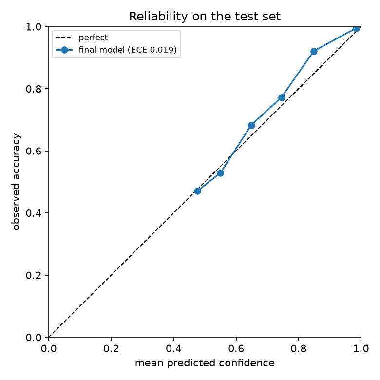
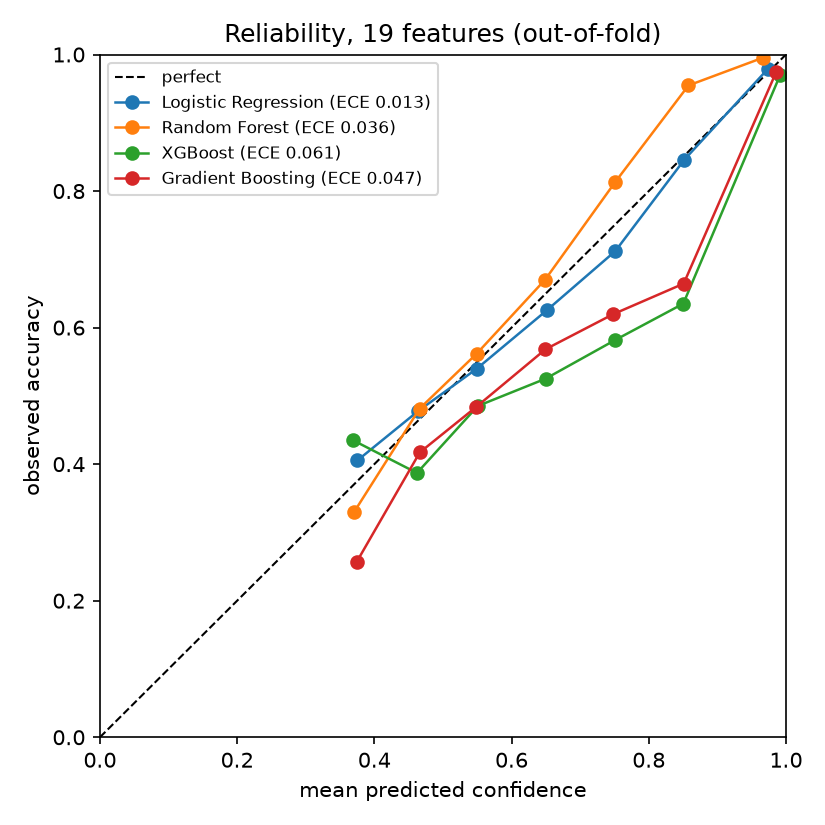
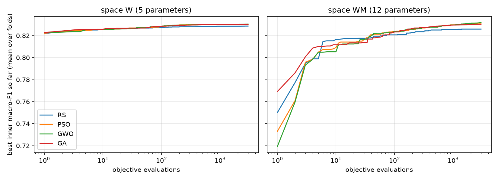
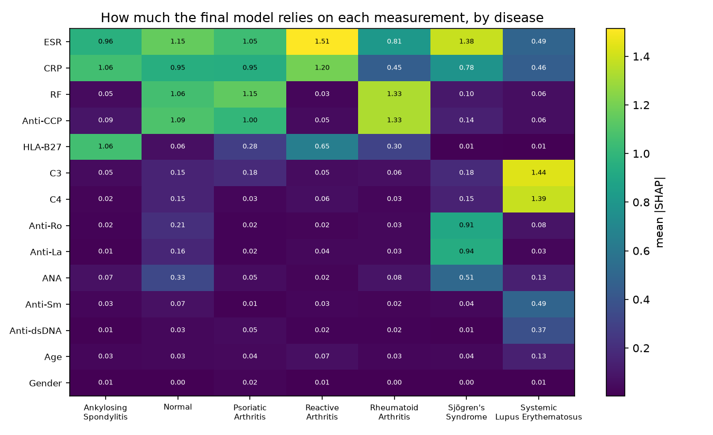
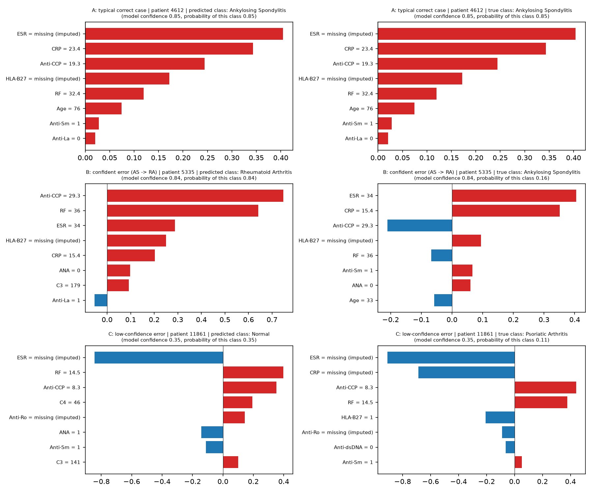
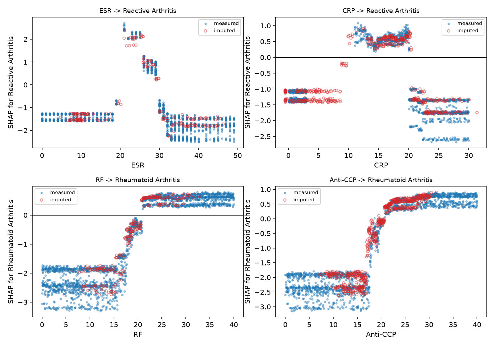

<p align="center">
  <h1 align="center">Multiclass Classification of Rheumatic & Autoimmune Diseases</h1>
  <p align="center">
    <strong>A Leakage-Safe, Statistically Controlled Machine Learning Study</strong>
  </p>
  <p align="center">
    <a href="https://www.python.org/downloads/release/python-3130/"></a>
    <a href="LICENSE"></a>
    <a href="notebooks/"></a>
    <a href="https://scikit-learn.org/"></a>
    <a href="https://xgboost.readthedocs.io/"></a>
    <a href="https://shap.readthedocs.io/"></a>
  </p>
</p>

---

> [!IMPORTANT]
> **Data Provenance & Clinical Validity Notice:** The underlying dataset from Harvard Dataverse (DOI [10.7910/DVN/VM4OR3](https://doi.org/10.7910/DVN/VM4OR3)) displays strong mathematical indicators of being simulated (every test column's missing count is an exact whole percentage of rows, and several measurements exhibit hard artificial caps; see `notebooks/01b_missingness_analysis.ipynb`). All findings describe model properties on this benchmark dataset, **not** real-world clinical validity.

---

## 📑 Table of Contents

- [📌 Project Overview](#-project-overview)
- [🏆 Headline Results](#-headline-results)
- [💡 Key Insights](#-key-insights)
- [🚫 What Did NOT Work (and Why That is a Result)](#-what-did-not-work-and-why-that-is-a-result)
- [🔬 Explainability & Biomarker Signatures](#-explainability--biomarker-signatures)
- [🔄 Pipeline Architecture](#-pipeline-architecture)
- [📁 Repository Structure](#-repository-structure)
- [🚀 Reproducibility](#-reproducibility)
- [⚠️ Limitations & Disclosures](#️-limitations--disclosures)
- [📜 Authorship & License](#-authorship--license)

---

## 📌 Project Overview

This repository provides a leakage-safe, statistically controlled machine-learning investigation into the multiclass classification of rheumatic and autoimmune disorders using the Harvard Dataverse *Rheumatic and autoimmune diseases dataset* (DOI [10.7910/DVN/VM4OR3](https://doi.org/10.7910/DVN/VM4OR3)).

* **Cohort:** 12,085 total patient records partitioned into a 9,668-patient training pool and a single, sealed 2,417-patient test set (80/20 stratified split).
* **Measurements:** 14 clinical and serology features — Age, Gender, ESR, CRP, RF, Anti-CCP, HLA-B27, ANA, Anti-Ro, Anti-La, Anti-dsDNA, Anti-Sm, C3, and C4.
* **Diagnoses (7 classes):** Rheumatoid Arthritis (RA), Ankylosing Spondylitis (AS), Sjögren's Syndrome, Psoriatic Arthritis (PsA), Normal, Systemic Lupus Erythematosus (Lupus), and Reactive Arthritis (ReA). Class imbalance is 5.5:1.
* **Missingness:** 12 of the 14 tests contain 9% to 43% missing values, distributed at exact integer percentages across the cohort.
* **Methodological Integrity:** Every modeling choice (imputation, scaling, feature selection, class weighting, hyperparameter tuning, and ensemble optimization) was pre-specified in the notebooks and decided strictly inside cross-validation folds on the training pool. The sealed test set was evaluated exactly once.
* **Final Model:** XGBoost trained on the 14 raw features without class weighting, using hyperparameters tuned by nested 5-fold cross-validation (`results/tuning_final_params.json`).

---

## 🏆 Headline Results

### Primary Benchmark Performance

| Evaluation Split | Macro-F1 (95% CI) | Accuracy | Balanced Accuracy | ROC-AUC (ovr) | ECE |
|---|---|---|---|---|---|
| **Final Model, Nested 5-fold CV** (9,668 patients) | **0.8254** [0.8168, 0.8336] | 0.839 | 0.825 | 0.983 | 0.015 |
| **Final Model, Untouched Test Set** (2,417 patients) | **0.8464** [0.8294, 0.8620] | **0.853** | **0.836** | **0.987** | **0.019** |
| Starting Pipeline (RF, balanced, 19 features), Test Set | 0.8344 | 0.848 | 0.847 | 0.984 | 0.037 |
| Majority-Class Dummy Baseline, Test Set | 0.0545 | 0.236 | 0.143 | 0.500 | — |

> [!NOTE]
> **Improvement Over Starting Pipeline:** The final tuned XGBoost yields a test Macro-F1 improvement of **+0.012**, with a 95% bootstrap CI of [-0.001, +0.026] and McNemar test p = 0.058. While consistent across CV folds (+0.008), this difference is modest and not individually statistically significant on the single test split.

### Per-Class Test Performance (2,417 patients)

| Diagnostic Class | Test Samples ($N$) | Precision | Recall | Test F1 Score | 95% CI |
|---|---|---|---|---|---|
| **Systemic Lupus Erythematosus** | 271 | 1.000 | 0.978 | **0.989** | [0.979, 0.996] |
| **Sjögren's Syndrome** | 370 | 0.858 | 0.949 | **0.901** | [0.879, 0.923] |
| **Psoriatic Arthritis** | 357 | 0.859 | 0.888 | **0.873** | [0.847, 0.898] |
| **Normal** | 321 | 0.923 | 0.826 | **0.872** | [0.843, 0.899] |
| **Rheumatoid Arthritis** | 570 | 0.799 | 0.942 | **0.865** | [0.844, 0.884] |
| **Reactive Arthritis** | 103 | 0.861 | 0.660 | **0.747** | [0.671, 0.814] |
| **Ankylosing Spondylitis** | 425 | 0.768 | 0.607 | **0.678** | [0.638, 0.714] |


*Figure 1: Test-set reliability diagram and calibration curve for the final tuned XGBoost model (Expected Calibration Error = 0.019).*


*Figure 2: 5-fold cross-validation calibration curves across baseline model families on the training pool.*

---

## 💡 Key Insights

### 1. Missing Tests Explain ~36% of Model Errors
* Missing test counts are a primary driver of misclassifications: test accuracy degrades monotonically from **0.90** when $\le 1$ test is missing down to **0.75** when 5 or more tests are omitted.
* Adjusted logistic regression indicates an error odds ratio of **1.32** per additional missing test on training CV, replicating at **1.29** on the test set.
* Incomplete diagnostic workups account for roughly 36% of all observed errors, whereas the remaining ~64% stem from intrinsic class boundary overlap among clinically similar inflammatory conditions.

### 2. The Model Knows When It Is Unsure (Confidence Deferral)
* Predicted class probability serves as an effective uncertainty filter: mean confidence is **0.872** on correct predictions versus **0.620** on errors.
* Deferring the least-confident 20% of cases removes **~62% of all test errors**, raising retained cohort accuracy to **0.931**.
* **Clinical Deferral Warning:** Deferral is not class-neutral. At an 80% overall retention rate, the model retains 100% of Lupus and 78% of RA cases, but only **~61% of Ankylosing Spondylitis** and **~68% of Reactive Arthritis** patients. Selective classification systems must report coverage disaggregated by disease class.

### 3. Hyperparameter Tuning Selectively Benefited XGBoost
* Nested cross-validation tuning yielded a statistically significant gain for XGBoost of **+0.008** macro-F1 (McNemar Holm $p = 0.0011$, winning in 5/5 folds), pulling it ahead of default Random Forest.
* In contrast, Random Forest tuning yielded no significant advantage (+0.0017, CI [-0.0021, 0.0055]), exhibiting a flat optimization landscape.
* All well-regularized tree ensemble families ultimately converged within ~0.003 of one another.

### 4. Learned Explanations Concord with Clinical Pathognomonic Patterns
* SHAP feature attributions precisely mirror established clinical rheumatology rules:
  * RF and Anti-CCP drive Rheumatoid Arthritis predictions.
  * HLA-B27 paired with inflammatory markers (ESR, CRP) dictates Ankylosing Spondylitis.
  * Anti-Ro and Anti-La drive Sjögren's Syndrome.
  * Complement depletion (C3 and C4) strongly identifies Systemic Lupus Erythematosus.
* Triangulation across three distinct feature importance paradigms (SHAP, permutation importance, and empirical cost of a missing test) demonstrated high rank correlation (Spearman $\rho = 0.78$ to $0.90$).

---

## 🚫 What Did NOT Work (and Why That is a Result)

Rigorous negative findings are critical to prevent wasteful modeling paths on tabular clinical data:

1. **Class Weighting Lowered Macro-F1:**
   Counter to common practice for imbalanced data (5.5:1 ratio), applying `balanced` class weighting degraded macro-F1 (+0.009 improvement without weighting on Random Forest). Synthetic oversampling via SMOTE-NC failed to improve any evaluation metric and collapsed Reactive Arthritis precision down to 0.52. Class weighting altered the operating objective—raising balanced accuracy by ~0.01 at the expense of macro-F1—and damaged calibration.
2. **Feature Engineering & Missingness Indicators Provided Zero Value:**
   Adding three engineered non-linear interactions, three literature-derived clinical indices, and two explicit missingness flags yielded no detectable gain (literature +0.0004, engineered +0.0015; all 95% CIs crossed zero). Furthermore, non-inferiority testing showed that no reduced feature subset could match the complete profile (dropping to top-8 features incurred a 0.03 macro-F1 loss). The 14 raw measurements proved optimal.
3. **Model Stacking and Meta-Optimization Yielded No Generalizable Gain:**
   Out-of-fold stacking of five diverse models (XGBoost, Random Forest, HistGradientBoosting, Logistic Regression, KNN) achieved a macro-F1 of 0.8260 versus 0.8254 for standalone tuned XGBoost—a statistically indistinguishable difference ($p = 1.0$).
4. **Nature-Inspired Swarm Optimization (PSO, GWO, GA) Over-Fitted:**
   Optimizing ensemble weights and class multipliers using Particle Swarm Optimization (PSO), Grey Wolf Optimizer (GWO), and Genetic Algorithms (GA) with 3,000 evaluations each failed to outperform simple random search. When tasked with tuning 12 parameters, swarm algorithms over-fitted to inner CV validation splits, exhibiting an inner-to-outer generalisation gap of 0.007–0.010 (compared to 0.003 for random search).


*Figure 3: Optimization trajectories of PSO, GWO, and GA across 3,000 objective evaluations compared against uniform random search.*

---

## 🔬 Explainability & Biomarker Signatures


*Figure 4: Mean absolute SHAP value per feature across all seven diagnostic classes.*


*Figure 5: Local SHAP force waterfall plots demonstrating biomarker attributions for individual patient cases.*


*Figure 6: SHAP dependence plots illustrating non-linear biomarker interaction boundaries across key serological assays.*

---

## 🔄 Pipeline Architecture

The study enforces strict separation of evaluation folds to preclude data leakage:

```mermaid
flowchart TD
    A[Raw Dataset: 12,085 patients] --> B[Stratified Split: 80% Train / 20% Test]
    B --> C[Sealed Test Set: 2,417 patients]
    B --> D[Training Pool: 9,668 patients]
    D --> E[5-Fold Stratified Nested CV]
    subgraph Fold_Execution [Fold-Safe Processing Inside Cross-Validation]
        E --> F[MICE Imputation: IterativeImputer]
        F --> G[StandardScaler Standardization]
        G --> H[Model Training & Hyperparameter Search]
    end
    H --> I[Pre-Specified Decision Rules<br/>• 14 raw features<br/>• No class weighting<br/>• Tuned XGBoost]
    I --> J[Fit Final Model on Full Training Pool]
    J --> K[Single Evaluation on Sealed Test Set]
    C --> K
    K --> L[Final Performance Metrics<br/>Macro-F1: 0.8464 | Accuracy: 0.853 | ECE: 0.019]
```

---

## 📁 Repository Structure

```
├── notebooks/                       # 13 sequentially executable research notebooks
│   ├── 01_eda.ipynb                 # Descriptive dataset exploration across all rows
│   ├── 01b_missingness_analysis.ipynb # Statistical missingness vs diagnosis checks
│   ├── 02_preproccessing.ipynb      # Leakage-safe train/test split & MICE preprocessing
│   ├── 03_stage1_plain_models.ipynb # Exploratory baselines on validation split
│   ├── 04_cross_validation.ipynb    # 5-fold CV benchmark & missingness flag ablation
│   ├── 05_imbalance_handling.ipynb   # Weighting, SMOTE-NC, and multiplier evaluation
│   ├── 06_feature_selection.ipynb   # Permutation importance & non-inferiority subset tests
│   ├── 07_hyperparameter_tuning.ipynb # Nested CV random search for tree ensembles
│   ├── 08_stacking.ipynb            # Nested out-of-fold multi-model stacking
│   ├── 09_nature_inspired_stacking.ipynb # Swarm meta-optimizers (PSO, GWO, GA)
│   ├── 10_final_evaluation.ipynb    # Single sealed test set evaluation & deferral
│   ├── 11_shap_explainability.ipynb # Global/local SHAP analysis & multi-method triangulation
│   └── 12_error_analysis.ipynb      # Missing test cost analysis & clinical failure modes
├── src/                             # Reusable production-grade modules
│   ├── preprocessing/
│   │   └── cv_pipeline.py           # Fold-safe imputation, scaling, and split loaders
│   └── evaluation/
│       └── metrics.py               # Paired bootstrap, McNemar, Holm tests, and ECE
├── results/                         # Frozen artifacts, tables, figures, and models
│   ├── final_freeze.json            # Pre-test frozen model parameters and hash specs
│   ├── final_model_xgb.json         # Serialized production XGBoost model
│   ├── environment.txt              # Exact frozen virtual environment package list
│   └── *.png / *.csv                # Metric tables, reliability curves, and SHAP plots
├── docs/
│   └── ANALYSIS_LOG.md              # Complete chronological evidence log for every notebook
├── data/
│   └── raw/
│       └── README.md                # Dataset download instructions & SHA-256 verification
├── requirements.txt                 # Pinned dependencies for reproduction
└── LICENSE                          # MIT License
```

For detailed per-notebook decision audits, statistical hypotheses, and complete numerical tabulations, refer to [`docs/ANALYSIS_LOG.md`](docs/ANALYSIS_LOG.md).

---

## 🚀 Reproducibility

### Environment Setup
Tested with Python 3.13.

```bash
# 1. Clone repository and set up a clean Python 3.13 virtual environment
git clone https://github.com/prathamkariya/Autoimmune-Disease.git
cd Autoimmune-Disease
python -m venv .venv

# Activate environment (Windows PowerShell)
.venv\Scripts\Activate.ps1
# Activate environment (Linux/macOS)
# source .venv/bin/activate

# 2. Install dependencies
pip install -r requirements.txt
```

> [!NOTE]
> `requirements.txt` contains the authoritative dependency specifications. `results/environment.txt` records the frozen package environment (including SHAP 0.52.0).

### Data Preparation & Execution

1. Obtain the dataset from Harvard Dataverse (DOI [10.7910/DVN/VM4OR3](https://doi.org/10.7910/DVN/VM4OR3)).
2. Place `dataset.xlsx` into `data/raw/` and verify its SHA-256 hash as documented in [`data/raw/README.md`](data/raw/README.md).
3. Execute the notebooks in sequential numeric order (`01` through `12`). Notebook `02` constructs `data/processed/`, which is consumed by downstream stages.

<details>
<summary>⏱️ Computational Runtime Expectations</summary>

* **Notebook 07 (`07_hyperparameter_tuning.ipynb`):** Longest runtime (~60+ minutes on consumer hardware) due to nested cross-validation search across trees.
* **Notebooks 04, 05, and 08:** Moderate runtimes (~10 to 25 minutes each).
* **Notebook 09 (`09_nature_inspired_stacking.ipynb`):** Automatically caches base-model out-of-fold predictions into `results/natstack_Z.npz` (~10–15 minutes initial generation; fast on subsequent runs).
* **Remaining Notebooks:** Fast execution (< 5 minutes each).
* Every notebook includes validation assertions checking against preceding stages, raising explicit warnings if intermediate numbers deviate.

</details>

---

## ⚠️ Limitations & Disclosures

1. **Simulated Dataset Artifacts:** The benchmark demonstrates definitive hallmarks of simulation (all missingness counts are exact integer percentages of the dataset; clinical measurements feature rigid caps). The data reflects textbook disease archetypes rather than clinical ambiguity.
2. **Prior Test-Set Exposure in Exploratory Work:** In prior exploratory work preceding this repository, unconstrained models were inspected on the test set. None of the final pipeline choices in this repository relied on those preliminary runs, and all modeling decisions were derived purely from cross-validation on the 9,668 training pool, but this history must be disclosed.
3. **Pre-Specification vs. External Pre-Registration:** Decision rules were pre-specified in the notebooks before viewing results, and the parameter freeze record (`results/final_freeze.json`) was generated 23 seconds before test evaluation. Because this repository was finalized in a clean history without third-party registry timestamps, the protocol represents notebook pre-specification rather than formal pre-registration.
4. **Optimism of Cross-Validation:** Feature selection, weighting schemes, and model architecture were evaluated across identical training folds; furthermore, the final deployed model was fitted on 25% more training instances (9,668 vs. 7,734 per fold). Test performance (0.8464) exceeded the CV interval [0.8168, 0.8336] because the single test partition proved slightly easier for all architectures (all candidate baselines shifted upwards by ~+0.02).
5. **Modest Final Delta:** The observed +0.012 Macro-F1 improvement over the starting pipeline is modest and not individually statistically significant on the single test split (McNemar $p = 0.058$).
6. **Exploratory Cohort Inspection:** Notebook `01_eda` inspected summary statistics across all 12,085 rows prior to data splitting. Its findings were purely descriptive, and the one engineering hypothesis it produced (missingness flags) was rejected during fold-safe CV.
7. **Seronegative Cutoff Thresholds:** The binary `Seronegative` feature used conventional laboratory cutoffs because specific clinical thresholds are undocumented in the Dataverse record.

---

## 📜 Authorship & License

* **Project Author & Lead:** Pratham Kariya.
* **Code License:** Released under the [MIT License](LICENSE).
* **Data Terms:** Benchmark data obtained from Harvard Dataverse (DOI [10.7910/DVN/VM4OR3](https://doi.org/10.7910/DVN/VM4OR3)). Dataset is subject to original repository terms and is not redistributed within this repository.