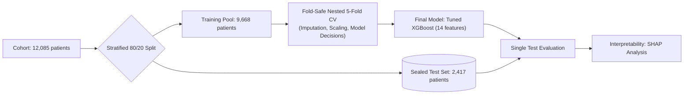

<div align="center">

# Multiclass Classification of Rheumatic & Autoimmune Diseases

**A leakage-safe, statistically controlled machine-learning study: every model, decision, and metric verified.**

[](https://www.python.org/)
[](LICENSE)
[](notebooks/)
[](https://scikit-learn.org/)
[](https://xgboost.readthedocs.io/)
[](https://shap.readthedocs.io/)

[At a Glance](#at-a-glance) · [Key Models](#key-models--performance) · [Results & Findings](#what-the-results-mean) · [Visual Interpretability](#visual-interpretability) · [Negative Results](#what-did-not-work) · [Study Pipeline](#how-the-study-was-run) · [Repository](#repository-structure) · [Reproducibility](#reproduce) · [Limitations](#limitations--disclosures) · [Author & License](#author--license)

</div>

---

> [!IMPORTANT]
> **Benchmark Dataset Notice:** The underlying data appear to be simulated: every test column's missing count is an exact whole percentage of the 12,085 rows, and several measurements exhibit artificial hard caps (see `notebooks/01b_missingness_analysis.ipynb`). Results describe model behaviour on this benchmark, **not** clinical performance.

---

## At a Glance

We evaluate multi-class diagnosis across 7 autoimmune conditions using 14 routine clinical and serological measurements from 12,085 patient records (Harvard Dataverse, DOI [10.7910/DVN/VM4OR3](https://doi.org/10.7910/DVN/VM4OR3)). Every architectural decision was made from fold-safe 5-fold cross-validation on 9,668 training patients. The 2,417-patient test set was evaluated exactly once.

| Metric | Nested 5-Fold CV (9,668 patients) | Untouched Test Set (2,417 patients) |
|---|:---:|:---:|
| **Macro-F1** | **0.825** [0.817, 0.834] | **0.846** [0.829, 0.862] |
| **Accuracy** | 0.839 | **0.853** |
| **Balanced Accuracy** | 0.816 | **0.836** |
| **ROC-AUC (ovr)** | 0.983 | **0.987** |
| **Expected Calibration Error (ECE)** | 0.015 | **0.019** |

> **Final Selected Model:** Tuned XGBoost on 14 raw features with no class weighting (`learning_rate=0.020`, `n_estimators=600`, `max_depth=4`, `colsample_bytree=0.57`, `subsample=0.81`).

### Core Takeaways

1. **Model Choice Hits a Ceiling:** Every well-regularized tree ensemble family lands within ~0.003 macro-F1 of one another. The ceiling is governed by clinical overlap and missing values, not classifier complexity.
2. **Missing Tests Explain About a Third of Errors (Estimate):** Each missing diagnostic test increases the odds of error by **$\times 1.32$** (replicated at **$\times 1.29$** on the test set).
3. **Uncertainty Deferral Works:** Rejecting the least-confident 20% of predictions eliminates **~62% of all test errors**, raising retained cohort accuracy to 93.1%.

---

## Key Models & Performance

Scores represent 5-fold cross-validation Macro-F1 (mean ± standard deviation across folds) on the 9,668 training pool.

| Role | Model | Configuration | CV Macro-F1 | Test Macro-F1 | Verdict |
|:---:|---|---|:---:|:---:|---|
| Baseline | **Majority-Class Dummy** | Constant baseline | n/a | 0.0545 | Empirical floor |
| Reference | **Random Forest (Starting Pipeline)** | Balanced weights, 19 features | 0.8175 ± 0.0081 | 0.8344 | Baseline reference point |
| Candidate | **Random Forest (Unweighted)** | No weights, 14 raw features | 0.8230 ± 0.0070 | 0.8430 | +0.0085 over the same 14 features with weights |
| Candidate | **XGBoost (Defaults)** | No weights, 14 raw features | 0.8174 ± 0.0057 | — | Starting point for tuning |
| Final | **XGBoost (Tuned)** | Nested CV random search | **0.8254 ± 0.0078** | **0.8464** | **Selected Final Model** (+0.0079 over default, 5/5 folds) |
| Ensemble | **5-Model Stacking Ensemble** | Logistic regression meta-learner | 0.8260 ± 0.0051 | — | Dropped: +0.0007 over tuned XGB (not significant) |
| Ensemble | **Swarm Optimizers (PSO/GWO/GA)** | 3,000 evaluations per optimizer | 0.8260 – 0.8283 | — | Dropped: equal budget random search scored 0.8284; over-fit inner folds |

<details>
<summary><strong>View full 15-model experimental progression table</strong></summary>

<br>

| Stage | Model / Change | Configuration | CV Macro-F1 | Outcome |
|:---:|---|---|:---:|---|
| 03 | Majority-Class Dummy | Always predicts largest class | n/a (test 0.0545) | Reference baseline |
| 04 | Logistic Regression | Balanced weights, 19 features | 0.7902 ± 0.0111 | Behind tree models by ~0.027 |
| 04 | Random Forest (Starting Pipeline) | Balanced weights, 19 features | 0.8175 ± 0.0081 | Initial benchmark (test 0.8344) |
| 04 | XGBoost (Defaults) | Balanced weights, 19 features | 0.8148 ± 0.0046 | Statistically tied with RF |
| 04 | Gradient Boosting (sklearn) | Balanced weights, 17 features | 0.8161 ± 0.0030 | Tied, but 36x slower to train |
| 05 | Random Forest (Unweighted) | 17 features | 0.8245 ± 0.0098 | Adopted: weighting cost ~0.009 |
| 05 | Random Forest + SMOTE-NC | 17 features | 0.8115 ± 0.0073 | Dropped: ReA precision fell to 0.52 |
| 06 | Random Forest (20 Candidate Features) | No weights | 0.8249 ± 0.0132 | No gain (+0.0004); 14 raw kept |
| 07 | Random Forest (Defaults) | No weights, 14 raw features | 0.8230 ± 0.0070 | Strong alternative (test 0.8430) |
| 07 | Random Forest (Tuned) | Nested random search | 0.8246 ± 0.0053 | Not significant (+0.0017); defaults kept |
| 07 | XGBoost (Defaults) | No weights, 14 raw features | 0.8174 ± 0.0057 | Starting point for tuning |
| 07 | **XGBoost (Tuned - Final Model)** | Nested random search | **0.8254 ± 0.0078** | **Selected**: +0.0079, significant in 5/5 folds (test 0.8464) |
| 08 | KNN / HistGradientBoosting / LogReg | Unweighted base learners | 0.7058 / 0.8125 / 0.7889 | Stacking ensemble inputs only |
| 08 | Stacking Ensemble (5 Models + LR) | Nested out-of-fold | 0.8260 ± 0.0051 | Dropped: +0.0007 over tuned XGB |
| 09 | Swarm Optimisation (PSO / GWO / GA) | 3,000 evaluations each | 0.8260 to 0.8283 | Dropped: no optimizer beat random search |

</details>

---

## What the Results Mean

### 1. Diagnosis-by-Diagnosis Breakdown (Test Set)

| Diagnostic Class | Test Samples | Precision | Recall | Test F1 | 95% CI | Key Biomarkers (SHAP) |
|---|:---:|:---:|:---:|:---:|:---:|---|
| **Systemic Lupus Erythematosus (SLE)** | 271 | 1.000 | 0.978 | **0.989** | [0.979, 0.996] | Complement depletion (low C3 & C4), low ESR/CRP |
| **Sjögren's Syndrome** | 370 | 0.858 | 0.949 | **0.901** | [0.879, 0.923] | High Anti-Ro & Anti-La, normal ESR/CRP |
| **Psoriatic Arthritis (PsA)** | 357 | 0.859 | 0.888 | **0.873** | [0.847, 0.898] | High ESR & CRP with low RF/Anti-CCP |
| **Normal** | 321 | 0.923 | 0.826 | **0.872** | [0.843, 0.899] | Normal inflammatory markers, negative autoantibodies |
| **Rheumatoid Arthritis (RA)** | 570 | 0.799 | 0.942 | **0.865** | [0.844, 0.884] | Elevated Anti-CCP & RF, high ESR/CRP |
| **Reactive Arthritis (ReA)** | 103 | 0.861 | 0.660 | **0.747** | [0.671, 0.814] | Intermediate inflammation, positive HLA-B27 |
| **Ankylosing Spondylitis (AS)** | 425 | 0.768 | 0.607 | **0.678** | [0.638, 0.714] | Positive HLA-B27, elevated CRP & ESR |

* **Easy vs. Challenging Diseases:** Lupus (F1 0.989) is almost perfectly recognized and Sjögren's (0.901) strongly so, thanks to distinctive serology (complement; anti-Ro/La). In contrast, **Ankylosing Spondylitis is the primary failure mode**: 26.8% of AS cases are misclassified as Rheumatoid Arthritis due to shared inflammatory profiles.

### 2. Missing Diagnostic Tests Hurt Performance

Accuracy drops steadily with missing laboratory assays:

| Missing Tests Count | Training CV Accuracy | Held-Out Test Accuracy |
|:---:|:---:|:---:|
| **0 – 1** | 0.897 | **0.900** |
| **2** | 0.865 | **0.868** |
| **3** | 0.830 | **0.845** |
| **4** | 0.804 | **0.834** |
| **5+** | 0.754 | **0.787** |

* **Single Tests That Cost the Most When Missing:** ESR (+13.2 error points), RF (+12.4 points), Anti-CCP (+6.5 points), and CRP (+3.8 points).

### 3. Confidence Deferral & Selective Classification

Confidence is informative and well calibrated (test ECE = 0.019; in training CV mean confidence is 0.872 on correct predictions and 0.620 on errors). Thresholds fixed on training data transfer reliably to the test set:

| Target Coverage | Realised Coverage | Retained Cohort Accuracy | Errors Filtered Out |
|:---:|:---:|:---:|:---:|
| **90%** | 90.9% | 0.888 | 31% |
| **80%** | 79.9% | **0.931** | **62%** |
| **70%** | 69.2% | 0.970 | 86% |
| **60%** | 61.2% | 0.993 | 97% |

> [!WARNING]
> **Deferral is Not Class-Neutral:** At 80% coverage, the system retains 100% of Lupus and 78% of RA, but only **61% of Ankylosing Spondylitis** and **68% of Reactive Arthritis** patients. Selective classification systems must report coverage disaggregated by disease class.

---

## Visual Interpretability

<p align="center">
  
  <br><em>Figure 1: Mean absolute SHAP value per biomarker across all 7 diagnostic classes.</em>
</p>

<p align="center">
  
  <br><em>Figure 2: Test-set calibration curve comparing stated model confidence to observed accuracy (ECE = 0.019).</em>
</p>

<p align="center">
  
  <br><em>Figure 3: Case-level SHAP attributions for a representative correct case and difficult boundary errors.</em>
</p>

---

## What Did NOT Work

Pre-specified negative findings are critical to prevent wasteful modeling iterations:

1. **Class Weighting Degraded Macro-F1:** `balanced` sample weighting decreased macro-F1 (Random Forest +0.009 without weighting: 0.8245 vs 0.8156). SMOTE-NC oversampling was never better than doing nothing and lowered Reactive Arthritis precision for Random Forest to 0.52 (0.75 without resampling).
2. **Engineered & Literature Features Added Zero Value:** Adding interaction terms, composite sums, a seronegative flag, or missingness flags gave no gain for Random Forest or XGBoost (every 95% CI crosses zero), and no smaller subset matched the full 14. Nothing beat the 14 raw features.
3. **Stacking & Swarm Ensembles Failed to Generalize:** A 5-model stack matched standalone XGBoost (0.8260 vs 0.8254, p = 1.0). Swarm optimizers (PSO, GWO, GA) over-fitted inner validation splits (0.007–0.010 gap) and failed to beat random search.

<p align="center">
  
  <br><em>Figure 4: Optimization trajectories of PSO, GWO, and GA across 3,000 evaluations versus random search.</em>
</p>

---

## How the Study Was Run



| Notebook | Focus Question | Key Empirical Finding |
|---|---|---|
| `01_eda` | What are cohort distributions and missingness? | 7 classes (5.5:1 imbalance); 12 tests with 9%–43% missing |
| `01b_missingness_analysis` | Does missingness indicate disease type? | No; nothing survives multiple-testing correction, and missing counts are exact whole percentages of the rows |
| `02_preproccessing` | How to structure data without leakage? | Split prior to fitting; fit imputer/scaler strictly on train folds |
| `03_stage1_plain_models` | How do first baselines behave? | Tree models about 0.80 on one validation split; nothing selected |
| `04_cross_validation` | Which model family performs best? | Tree ensembles tie; Logistic Regression is significantly worse |
| `05_imbalance_handling` | Should we apply class weights or SMOTE? | No class weighting achieves highest macro-F1 |
| `06_feature_selection` | Do engineered or literature features help? | No; nothing beat the 14 raw features |
| `07_hyperparameter_tuning` | Does tuning improve tree ensembles? | XGBoost gains +0.008 (significant); RF remains flat |
| `08_stacking` | Does out-of-fold multi-model stacking help? | No; the stack is statistically indistinguishable from tuned XGBoost |
| `09_nature_inspired_stacking` | Can swarm algorithms optimize weights? | No; swarm algorithms overfit inner validation folds |
| `10_final_evaluation` | What is true unseen test performance? | Macro-F1 **0.8464**, Accuracy **0.853**, ECE **0.019** |
| `11_shap_explainability` | What biomarker mechanisms were learned? | Learned rules are consistent with textbook rheumatology |
| `12_error_analysis` | What drives residual errors? | Missing tests (~36% of errors, an estimate) and disease overlap (the remaining ~64%) |

*Full evidence, statistical test tables, and confidence bounds are logged in [`docs/ANALYSIS_LOG.md`](docs/ANALYSIS_LOG.md).*

---

## Repository Structure

```
├── notebooks/                       # 13 sequentially executable research notebooks
├── src/                             # Reusable core modules
│   ├── preprocessing/cv_pipeline.py # Fold-safe pipeline logic (imputer, scaler)
│   └── evaluation/metrics.py        # Paired bootstrap, McNemar, Holm tests, ECE
├── results/                         # Frozen artifacts, tables, figures, final model
│   ├── final_freeze.json            # Frozen specification and input checksums
│   ├── final_model_xgb.json         # Serialized final production model
│   └── environment.txt              # Frozen execution environment
├── docs/ANALYSIS_LOG.md             # Complete evidence audit log
├── data/raw/README.md               # Dataset download & verification instructions
├── requirements.txt                 # Pinned dependencies
└── LICENSE                          # MIT License
```

---

## Reproduce

Tested with **Python 3.13**.

```bash
# 1. Clone repository & configure virtual environment
git clone https://github.com/prathamkariya/Autoimmune-Disease.git
cd Autoimmune-Disease
python -m venv .venv

# Activate: Windows PowerShell
.venv\Scripts\Activate.ps1
# Activate: Linux/macOS
# source .venv/bin/activate

# 2. Install dependencies
pip install -r requirements.txt
```

1. Download `dataset.xlsx` from Harvard Dataverse into `data/raw/` and verify its SHA-256 hash using [`data/raw/README.md`](data/raw/README.md).
2. Execute notebooks sequentially (`01`, `01b`, then `02` through `12`). Notebook `02` constructs `data/processed/`.

<details>
<summary><strong>Execution Runtime Estimates</strong></summary>

* **Notebook 07 (Tuning):** ~60+ minutes (nested random search across trees).
* **Notebooks 04, 05, and 08:** ~10 to 25 minutes each.
* **Notebook 09 (Swarm Stacking):** ~10 to 15 minutes initial run (caches predictions to `results/natstack_Z.npz`).
* **Remaining Notebooks:** Fast execution (< 5 minutes each).

</details>

---

## Limitations & Disclosures

1. **Simulated Benchmark Data:** Cohort missingness counts are exact integer percentages of total rows, and several features display artificial hard caps. Findings reflect benchmark properties, not clinical efficacy.
2. **Prior Exploratory Test Exposure:** In exploratory iterations prior to this clean repository, baseline models were run on the test set. Final choices depended solely on cross-validation within the training pool, but this history is disclosed for transparency.
3. **Pre-Specified, Not Pre-Registered:** Decision rules were written in the notebooks before their results existed. `results/final_freeze.json` was generated by notebook 10 about 23 seconds before the test predictions, in a single run, and the repository history has no independent timestamp for it.
4. **CV Estimate vs. Test Score:** The test macro-F1 (0.8464) exceeded the CV interval [0.8168, 0.8336], most likely because this test partition is somewhat easier (every model, including the starting pipeline, shifted up by about 0.02) and because the final model trains on 25% more patients than each fold model. The CV estimate is itself mildly optimistic, since weighting, features, and model family were chosen on the same folds.
5. **Modest Final Delta:** The observed +0.012 Macro-F1 improvement over the starting pipeline is consistent but modest (McNemar $p = 0.058$).
6. **No External Validation:** One dataset and one train/test split.
7. **Exploratory Analysis Scope:** Notebook 01 looked at all 12,085 patients before the split; it was descriptive only.
8. **Seronegative Feature:** It uses conventional cut-offs (RF < 14, anti-CCP < 20) because the dataset's own thresholds are undocumented.

---

## Author & License

<p align="left">
  <a href="https://github.com/prathamkariya">
    
  </a>
</p>

**Pratham Kariya**  
* GitHub: [@prathamkariya](https://github.com/prathamkariya)
* Repository: [Autoimmune-Disease](https://github.com/prathamkariya/Autoimmune-Disease)

### License & Terms
* **Code:** Licensed under the [MIT License](LICENSE).
* **Dataset:** Harvard Dataverse (DOI [10.7910/DVN/VM4OR3](https://doi.org/10.7910/DVN/VM4OR3)). Data is not redistributed in this repository.
