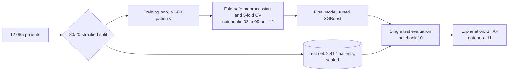

<div align="center">

# Multiclass Classification of Rheumatic and Autoimmune Diseases

**A leakage-safe, statistically controlled machine-learning study: every model, every decision, every number traceable.**

[](https://www.python.org/)
[](LICENSE)
[](notebooks/)
[](https://scikit-learn.org/)
[](https://xgboost.readthedocs.io/)
[](https://shap.readthedocs.io/)

[At a glance](#-at-a-glance) · [Model journey](#-the-modelling-journey) · [What the results mean](#-what-the-results-mean) · [What did not work](#-what-did-not-work) · [How it was run](#-how-the-study-was-run) · [Repository](#-repository) · [Reproduce](#-reproduce) · [Limitations](#-limitations-and-disclosures)

</div>

> [!IMPORTANT]
> **The data appear to be simulated.** Every test's missing count is an exact whole percentage of the 12,085 rows, and several measurements have hard caps (see `notebooks/01b_missingness_analysis.ipynb`). Results describe model behaviour on this benchmark, **not** clinical performance.

## 🎯 At a glance

Seven diagnoses, 14 clinical and serology measurements, 12,085 patients (Harvard Dataverse, DOI [10.7910/DVN/VM4OR3](https://doi.org/10.7910/DVN/VM4OR3)). We built and compared six model families plus stacked and swarm-optimised ensembles, and decided every step by cross-validation on 9,668 training patients. The 2,417-patient test set was opened exactly once.

| Test macro-F1 | Nested-CV macro-F1 | Test accuracy | Test ROC-AUC | Calibration (ECE) |
|:---:|:---:|:---:|:---:|:---:|
| **0.846** | 0.825 | 0.853 | 0.987 | 0.019 |
| [0.829, 0.862] | [0.817, 0.834] | | | |

**Final model:** XGBoost on the 14 raw measurements, no class weighting, hyper-parameters tuned by nested cross-validation (600 trees, depth 4, learning rate 0.020).

**Three takeaways**

1. **Model choice barely matters here.** Every well-configured tree ensemble lands within about 0.003 macro-F1 of the others in cross-validation. The ceiling is set by the data, not by model sophistication.
2. **Missing tests are the main avoidable source of error.** Each extra missing test multiplies the odds of a wrong prediction by 1.32, and the effect replicates on the test set (1.29).
3. **The model knows when it is unsure.** Deferring the least-confident 20% of patients removes about 62% of the errors on the test set, but deferral is not equally kind to every disease (see below).

## 🧭 The modelling journey

Every model we built, in the order we built it. Scores are 5-fold cross-validation macro-F1 (mean ± standard deviation across folds) unless stated; "stage" is the notebook number. The settings differ between rows on purpose: each row changes one thing and tests whether it helped.

| Stage | Model / change | Setting | CV macro-F1 | Outcome |
|:---:|---|---|:---:|---|
| 03 | Majority-class dummy | always predicts the largest class | n/a (test 0.0545) | The floor every real model must beat |
| 04 | Logistic Regression | balanced weights, 19 features | 0.7902 ± 0.0111 | Clearly behind the tree models (about 0.027 lower) |
| 04 | **Random Forest, starting pipeline** | balanced weights, 19 features | 0.8175 ± 0.0081 | The reference point (test macro-F1 0.8344) |
| 04 | XGBoost, defaults | balanced weights, 19 features | 0.8148 ± 0.0046 | Statistically tied with Random Forest |
| 04 | Gradient Boosting (scikit-learn) | balanced weights, 17 features | 0.8161 ± 0.0030 | Tied, but about 36 times slower to train |
| 05 | **Random Forest without class weights** | 17 features | 0.8245 ± 0.0098 | **Adopted**: weighting was costing about 0.009 |
| 05 | Random Forest with SMOTE-NC oversampling | 17 features | 0.8115 ± 0.0073 | Dropped: lower, and Reactive Arthritis precision fell to 0.52 |
| 06 | Random Forest with all 20 candidate features | no weights | 0.8249 ± 0.0132 | No real gain (+0.0004), so the 14 raw features were kept |
| 07 | **Random Forest, defaults** | no weights, 14 raw features | 0.8230 ± 0.0070 | Strongest alternative (test macro-F1 0.8430) |
| 07 | Random Forest, tuned | nested random search | 0.8246 ± 0.0053 | Not significant (+0.0017); defaults kept |
| 07 | XGBoost, defaults | no weights, 14 raw features | 0.8174 ± 0.0057 | Starting point for tuning |
| 07 | **XGBoost, tuned (final model)** | nested random search | 0.8254 ± 0.0078 | **Adopted**: +0.0079, significant in 5 of 5 folds; test macro-F1 0.8464 |
| 08 | KNN, HistGradientBoosting, Logistic Regression | unweighted base learners | 0.7058 / 0.8125 / 0.7889 | Weaker; used only as ensemble members |
| 08 | Stacking: 5 models + logistic-regression meta-learner | nested out-of-fold | 0.8260 ± 0.0051 | Not adopted: +0.0007 over tuned XGBoost, not significant |
| 09 | Swarm-optimised ensembles (PSO, GWO, GA) | 3,000 evaluations each | 0.8260 to 0.8283 (weights only) | Not adopted: random search reached 0.8284 with the same budget |

> [!NOTE]
> **How to read the gaps.** Fold-to-fold spread is about 0.005 to 0.010 and a single score carries a 95% interval of roughly ±0.008. Paired comparisons on the same patients can resolve differences of about 0.004 or more, so rows within 0.003 of each other are ties. The changes that clearly beat that bar, and were kept, are dropping class weights (Random Forest) and tuning (XGBoost); engineered features helped Gradient Boosting and Logistic Regression slightly but not the models we kept.

**The story in one paragraph.** We started from a class-balanced Random Forest (0.834 on test). Removing the class weights helped; adding engineered or literature-inspired features did not; tuning helped XGBoost but not Random Forest; stacking five models and optimising the ensemble with three swarm algorithms added nothing a random search could not already find. The final model is therefore the simplest one that is statistically at the top: a tuned XGBoost on the raw measurements. On the sealed test set it scores 0.846 against 0.834 for the starting pipeline, a difference of +0.012 (95% interval [-0.001, +0.026], McNemar p = 0.058): consistent with cross-validation, but too small to claim significance on one test split.

## 🔬 What the results mean

### Where the final model succeeds and fails

| Disease | Test patients | Precision | Recall | F1 | 95% CI | What the model keys on (SHAP) |
|---|:---:|:---:|:---:|:---:|:---:|---|
| Systemic Lupus Erythematosus | 271 | 1.000 | 0.978 | **0.989** | [0.979, 0.996] | Low C3 and C4 (complement), low ESR and CRP |
| Sjögren's Syndrome | 370 | 0.858 | 0.949 | **0.901** | [0.879, 0.923] | High anti-La and anti-Ro, low ESR and CRP |
| Psoriatic Arthritis | 357 | 0.859 | 0.888 | **0.873** | [0.847, 0.898] | High ESR and CRP with low RF and anti-CCP |
| Normal | 321 | 0.923 | 0.826 | **0.872** | [0.843, 0.899] | Low ESR, CRP, RF and anti-CCP |
| Rheumatoid Arthritis | 570 | 0.799 | 0.942 | **0.865** | [0.844, 0.884] | High anti-CCP and RF, high ESR and CRP |
| Reactive Arthritis | 103 | 0.861 | 0.660 | **0.747** | [0.671, 0.814] | Lower ESR and CRP raise its score; high HLA-B27 |
| Ankylosing Spondylitis | 425 | 0.768 | 0.607 | **0.678** | [0.638, 0.714] | High HLA-B27 with high CRP and ESR |

Lupus and Sjögren's syndrome are nearly solved because they have a distinctive serology (complement and anti-Ro/La). **Ankylosing Spondylitis is the hard case:** 26.8% of its patients are predicted as Rheumatoid Arthritis, because the two share an inflammatory profile. **Reactive Arthritis** is limited by size (103 test patients, wide interval) and a recall of 0.660. The next most frequent confusion is Normal predicted as Sjögren's (16.2% of Normal patients).

### Missing tests drive errors

Accuracy falls steadily as more of the 12 tests are missing, on training cross-validation and again on the held-out test set:

| Missing tests | Accuracy, training CV | Accuracy, test set |
|:---:|:---:|:---:|
| 0-1 | 0.897 | 0.900 |
| 2 | 0.865 | 0.868 |
| 3 | 0.830 | 0.845 |
| 4 | 0.804 | 0.834 |
| 5+ | 0.754 | 0.787 |

Adjusted for the true disease, each extra missing test multiplies the odds of an error by **1.32** (95% CI [1.26, 1.37]) in training and **1.29** ([1.19, 1.41]) on the test set. Comparing patients with at most one missing test against everyone suggests that about 36% of errors are attributable to missing tests; the other roughly 64% remain even with nearly complete data, which points to genuine overlap between diseases. Which missing test hurts most:

| Test missing | Extra error rate when missing |
|---|:---:|
| ESR | +13.2 points |
| RF | +12.4 points |
| Anti-CCP | +6.5 points |
| CRP | +3.8 points |

### The model knows when it is unsure

Confidence (the top class probability) separates right from wrong predictions: on training cross-validation the mean is 0.872 for correct and 0.620 for wrong predictions. Thresholds fixed on training data transferred cleanly to the test set:

| Target coverage | Realised coverage | Accuracy on kept patients | Errors deferred |
|:---:|:---:|:---:|:---:|
| 90% | 90.9% | 0.888 | 31% |
| 80% | 79.9% | 0.931 | 62% |
| 70% | 69.2% | 0.970 | 86% |
| 60% | 61.2% | 0.993 | 97% |
| 50% | 55.9% | 0.998 | 99% |

> [!WARNING]
> **Deferral is not class-neutral.** At 80% overall coverage the rule keeps 100% of Lupus and 78% of Rheumatoid Arthritis patients but only 61% of Ankylosing Spondylitis and 68% of Reactive Arthritis patients; at 60% coverage only 25% of Reactive Arthritis patients remain. Part of the high accuracy at low coverage comes from removing the hardest diseases. Always report coverage per disease.

### What the model learned

The seven most relied-upon measurements (mean absolute SHAP value): ESR 1.05, CRP 0.83, RF 0.54, Anti-CCP 0.54, HLA-B27 0.34, C3 0.30, C4 0.26. The learned rules match textbook rheumatology: anti-CCP and RF for Rheumatoid Arthritis, HLA-B27 with raised inflammatory markers for Ankylosing Spondylitis, anti-Ro and anti-La for Sjögren's syndrome, low complement for lupus. Three independent importance measures (SHAP, permutation importance, and the cost of a missing test) agree with rank correlations of 0.78 to 0.90.

<p align="center"><br><em>Figure 1. How much the final model relies on each measurement, by disease (mean absolute SHAP value, test set).</em></p>

<p align="center"><br><em>Figure 2. Reliability on the test set: stated confidence versus observed accuracy (ECE 0.019).</em></p>

<p align="center"><br><em>Figure 3. The eight largest SHAP contributions for three patients chosen by rule: a typical correct case, the most confident Ankylosing Spondylitis to Rheumatoid Arthritis error, and the least-confident error.</em></p>

## 🚫 What did not work

Negative results are results; each of these was tested with a rule written before the outcome was known.

- **Class weighting lowered macro-F1.** Random Forest scored 0.8245 without weights against 0.8156 with them. Weighting trades precision for recall (balanced accuracy rises by about 0.01) so the right choice depends on which objective matters; SMOTE-NC oversampling was never better than doing nothing.
- **Extra features gave nothing to the final model family.** Three engineered features (an ESR plus CRP composite, a C3/C4 ratio, an antibody sum), three literature-inspired ones (a seronegative flag and two product terms) and two missingness flags gave no gain for Random Forest or XGBoost (every confidence interval included zero), and no smaller feature subset matched the full 14 (the top 8 lost about 0.03).
- **Stacking and swarm optimisation did not generalise.** Stacking scored 0.8260 against 0.8254 for the single XGBoost. PSO, Grey Wolf and a genetic algorithm, given 3,000 evaluations each to tune ensemble weights and class multipliers, did no better than random search; with 12 parameters they over-fitted their own validation predictions (inner-to-outer gap 0.007 to 0.010, against 0.003 for random search).

<p align="center"><br><em>Figure 4. Best validation score found so far versus evaluations, averaged over folds, for the swarm optimisers and random search.</em></p>

## 🧩 How the study was run



Anything that learns from data (imputation, scaling, resampling, feature selection, tuning) is fitted inside the training part of each fold. Choices are made from cross-validation with uncertainty (paired bootstrap, McNemar's test, Holm correction) using rules written in each notebook before its result existed.

| # | Notebook | Question | Answer in one line |
|:---:|---|---|---|
| 01 | `01_eda` | What does the data look like? | Seven classes (5.5 to 1 imbalance); 12 tests with 9% to 43% missing |
| 01b | `01b_missingness_analysis` | Is a missing value informative? | No: the RF signal (p = 0.0055) becomes p = 0.066 after correction; gaps look inserted at fixed rates |
| 02 | `02_preproccessing` | How do we preprocess without leakage? | Split first; fit imputer and scaler on training data only |
| 03 | `03_stage1_plain_models` | First baselines on a validation split | Tree models about 0.80 on one split; nothing selected |
| 04 | `04_cross_validation` | Honest model comparison | Tree models tie; logistic regression is clearly worse |
| 05 | `05_imbalance_handling` | Weights, SMOTE-NC or nothing? | Nothing: no class weights |
| 06 | `06_feature_selection` | Which features? | The 14 raw ones |
| 07 | `07_hyperparameter_tuning` | Does tuning pay? | Yes for XGBoost (+0.0079), no for Random Forest |
| 08 | `08_stacking` | Do ensembles help? | No |
| 09 | `09_nature_inspired_stacking` | Can swarm optimisers do better? | No; they over-fit |
| 10 | `10_final_evaluation` | How good is the final model? | Test macro-F1 0.8464 |
| 11 | `11_shap_explainability` | What did it learn? | Clinically plausible rules |
| 12 | `12_error_analysis` | Why does it fail? | Missing tests and disease overlap |

The complete evidence for every decision is in [`docs/ANALYSIS_LOG.md`](docs/ANALYSIS_LOG.md).

## 📁 Repository

```
notebooks/   13 executed notebooks (run in order: 01, 01b, 02 ... 12)
src/         preprocessing/cv_pipeline.py (fold-safe preprocessing)
             evaluation/metrics.py (paired bootstrap, McNemar, Holm, calibration)
results/     tables (.csv), figures (.png), the frozen specification and the final model
docs/        ANALYSIS_LOG.md (decisions, evidence, findings, disclosures)
data/raw/    README.md (where to get the dataset and its SHA-256 checksum)
```

Result files are prefixed by the notebook that wrote them: `missingness_` (01b), `stage1_val_` (03), `cv5_` (04), `imb_` (05), `fs_` (06), `tune_` and `tuning_` (07), `stack_` (08), `natstack_` (09), `final_` (10), `shap_` (11), `err_` (12). The fitted model is `results/final_model_xgb.json`; the frozen specification is `results/final_freeze.json`.

## 🧪 Reproduce

Tested with Python 3.13.

```bash
git clone https://github.com/prathamkariya/Autoimmune-Disease.git
cd Autoimmune-Disease
python -m venv .venv
# Windows PowerShell: .venv\Scripts\Activate.ps1      Linux/macOS: source .venv/bin/activate
pip install -r requirements.txt
```

1. Download `dataset.xlsx` from the Dataverse page above into `data/raw/` and check its SHA-256 as described in [`data/raw/README.md`](data/raw/README.md).
2. Run the notebooks in order (`01`, `01b`, `02` through `12`). Notebook `02` creates `data/processed/`, which the later notebooks read.

<details>
<summary>Runtime expectations</summary>

- Notebook 07 is the slowest (about an hour or more on a laptop).
- Notebooks 04, 05 and 08 take roughly 10 to 25 minutes each; 09 needs about 10 to 15 minutes the first time (it caches base-model predictions in `results/natstack_Z.npz`).
- The rest take a few minutes. Every notebook checks that it reproduces the numbers of the notebook before it and prints a `WARNING` if not.

</details>

## 🚧 Limitations and disclosures

1. **Simulated-looking data.** No external validation and a single train/test split; the data follow textbook disease patterns rather than clinical ambiguity.
2. **Earlier test-set exposure.** In an earlier version of this analysis, exploratory notebooks compared models on the test set. No final choice depended on those looks and those notebooks are not in this repository, but it must be disclosed.
3. **Pre-specified, not pre-registered.** Decision rules were written in the notebooks before the results. `results/final_freeze.json` was generated 23 seconds before the test evaluation, and the repository has no independent timestamp.
4. **Cross-validation is mildly optimistic,** because weighting, features and model family were chosen on the same folds. The test score (0.8464) is above the cross-validation interval most likely because this test split is somewhat easier: every model, including the starting pipeline, moved up by about 0.02, and the final model also trains on 25% more patients than each fold model.
5. **The improvement over the starting pipeline is modest** (+0.012, McNemar p = 0.058).
6. **Exploratory analysis** (notebook 01) looked at all 12,085 patients before the split; it was descriptive only.
7. **The `Seronegative` feature uses conventional cut-offs,** because the dataset's own thresholds are undocumented.

## 🙏 Credits and licence

**Author:** Pratham Kariya. The exploratory analysis and the original preprocessing and cross-validation pipeline come from [shaambhavi-dubey/autoimmune-diseases](https://github.com/shaambhavi-dubey/autoimmune-diseases); the leakage fixes, the evaluation framework and notebooks 01b to 12 were added afterwards.

Code is released under the [MIT License](LICENSE). The data are subject to the terms of the original Harvard Dataverse record and are not redistributed here.
